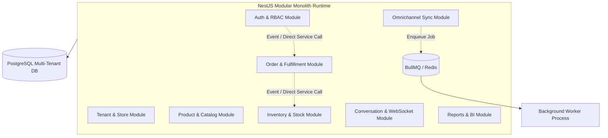

# Kiến Trúc Hệ Thống Tổng Thể — Architecture Overview

> Trạng thái thông tin: `[PROPOSED]` Định hướng kiến trúc kỹ thuật bởi Solution Architect & Senior Technical Lead.

Tài liệu này xác lập các nguyên tắc kiến trúc nền tảng của hệ thống **NEXORA — Commerce Management Platform**, lý giải quyết định lựa chọn mô hình **Modular Monolith** và các quy chuẩn thiết kế phần mềm hiện đại.

---

## 1. Triết Lý Kiến Trúc: Modular Monolith

Tại giai đoạn khởi tạo và tăng trưởng ban đầu, NEXORA kiên định lựa chọn mô hình **Modular Monolith**, không áp dụng Microservices ngay từ đầu.

### Tại sao chọn Modular Monolith thay vì Microservices?
1. **Tối ưu chi phí hạ tầng:** Giảm thiểu chi phí vận hành máy chủ, mạng nội bộ và chi phí duy trì cụm Kubernetes phức tạp.
2. **Đơn giản hóa giao dịch dữ liệu:** Các tác vụ then chốt (như Tạo đơn hàng + Khấu trừ tồn kho + Ghi nhật ký giao dịch) có thể thực hiện thông qua **Database Transaction ACID** cục bộ, loại bỏ hoàn toàn bài toán Distributed Transactions (Saga pattern) phức tạp và tiềm ẩn rủi ro sai lệch dữ liệu.
3. **Tốc độ phát triển (Velocity):** Đội ngũ lập trình viên có thể di chuyển nhanh, tái sử dụng các lớp Data Transfer Objects (DTO) và Type definitions trong cùng một codebase.
4. **Sẵn sàng chia tách tương lai:** Bằng cách giữ cho các module trong NestJS **tuyệt đối độc lập về ranh giới dữ liệu** (chỉ gọi qua Service công khai hoặc bắn Domain Events), bất kỳ module nào chịu tải đột biến (ví dụ: `OmnichannelModule` hoặc `ChatModule`) đều có thể trích xuất thành Microservice độc lập sau này mà không cần đập đi xây lại.

---

## 2. Các Nguyên Tắc Kiến Trúc Cốt Lõi (Core Principles)

- **Multi-Tenant Native:** Multi-tenancy không phải là tính năng bổ sung sau, mà là tư duy thiết kế xuyên suốt từ tầng Database, Service đến UI Context.
- **Separation of Concerns (SoC):** Tách bạch rõ ràng giữa Presentation Layer (Controllers / Gateways), Business Logic Layer (Services), và Data Access Layer (Prisma Repositories).
- **Clean Architecture & SOLID:** Tuân thủ nguyên tắc Single Responsibility, Dependency Inversion (tiêm phụ thuộc qua NestJS DI Container).
- **Asynchronous by Default for Heavy Tasks:** Mọi tác vụ liên quan đến bên thứ ba (Shopee, TikTok, Meta API, Gửi email, Tạo báo cáo nặng) bắt buộc phải xử lý bất đồng bộ thông qua hàng đợi Redis / BullMQ.
- **Fail-Fast & Defensive Programming:** Kiểm tra dữ liệu đầu vào bằng `class-validator` (Backend) và `zod` (Frontend) trước khi chuyển vào tầng xử lý logic.
- **Audit Everything:** Mọi thao tác ghi/sửa/xóa dữ liệu nhạy cảm đều phải lưu vết vào bảng `audit_logs`.

---

## 3. Bản Đồ Tài Liệu Kiến Trúc Chi Tiết

- [**SYSTEM_OVERVIEW.md**](./SYSTEM_OVERVIEW.md): Sơ đồ C4 Context & Container trực quan hóa toàn bộ thành phần hệ thống.
- [**TECH_STACK.md**](./TECH_STACK.md): Báo cáo công nghệ, giải trình phiên bản và tính tương thích.
- [**FRONTEND_ARCHITECTURE.md**](./FRONTEND_ARCHITECTURE.md): Kiến trúc ứng dụng Next.js App Router, quản lý State và caching client.
- [**BACKEND_ARCHITECTURE.md**](./BACKEND_ARCHITECTURE.md): Cấu trúc Module NestJS, Dependency Injection và Domain Events.
- [**MULTI_TENANT.md**](./MULTI_TENANT.md): Chiến lược phân tách dữ liệu Multi-Tenant (Tenant Context, RLS).
- [**SECURITY.md**](./SECURITY.md): Chính sách bảo mật JWT, RBAC, Data Encryption và Rate Limiting.
- [**INTEGRATION_ARCHITECTURE.md**](./INTEGRATION_ARCHITECTURE.md): Kiến trúc tiếp nhận Webhook, hàng đợi BullMQ và tích hợp sàn TMĐT.
- [**DEPLOYMENT.md**](./DEPLOYMENT.md): Hạ tầng Docker Compose, cấu hình Nginx Reverse Proxy và quy trình CI/CD.
