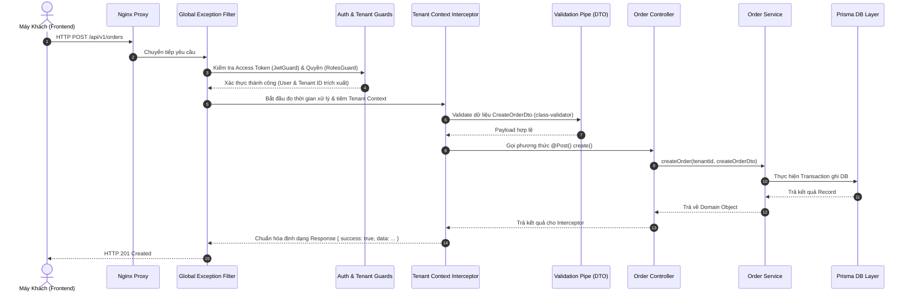

# Kiến Trúc Máy Chủ Dịch Vụ — Backend Architecture

> Trạng thái thông tin: `[PROPOSED]` Định hướng kiến trúc NestJS Modular Monolith bởi Solution Architect.

Tài liệu này chi tiết hóa cấu trúc tổ chức mã nguồn, phân tầng trách nhiệm (Layered Architecture), cơ chế tiêm phụ thuộc (Dependency Injection) và luồng xử lý yêu cầu (Request Lifecycle) trong hệ thống **NestJS** của **NEXORA**.

---

## 1. Cấu Trúc Module Chuẩn (Standard Module Layout)

Mỗi module nghiệp vụ nằm trong `src/modules/[module-name]/` tuân thủ nghiêm ngặt cấu trúc đồng nhất:

```text
src/modules/orders/
├── controllers/          # Lớp tiếp nhận HTTP Requests & định nghĩa API Route
│   └── orders.controller.ts
├── services/             # Lớp chứa toàn bộ nghiệp vụ cốt lõi (Business Logic)
│   └── orders.service.ts
├── dto/                  # Data Transfer Objects (Validation bằng class-validator)
│   ├── create-order.dto.ts
│   ├── update-order.dto.ts
│   └── order-filter.dto.ts
├── entities/             # Định nghĩa Type / Interface của Domain Entity
│   └── order.entity.ts
├── events/               # Domain Events được phát ra khi trạng thái thay đổi
│   ├── order-created.event.ts
│   └── order-cancelled.event.ts
└── orders.module.ts      # Khai báo Controller, Service và Export cho module khác
```

---

## 2. Vòng Đời Yêu Cầu HTTP (Request Lifecycle)

Mỗi yêu cầu từ máy khách đi qua một chuỗi các bộ lọc và trung gian trước khi chạm đến Business Logic:



---

## 3. Giao Tiếp Giữa Các Module (Inter-Module Communication)

Để bảo toàn nguyên tắc ghép nối lỏng (Loose Coupling) trong mô hình Modular Monolith:

1. **Gọi trực tiếp qua Service (Synchronous Query/Command):**
   - Chỉ được phép tiêm (Inject) Service của module khác nếu module đó chủ động `exports: [OtherService]` trong file `.module.ts`.
   - Tuyệt đối cấm Module A truy vấn trực tiếp bảng của Module B bằng Prisma Client nếu không thông qua Service của Module B.

2. **Giao tiếp qua Domain Events (Asynchronous Decoupling):**
   - Khi một sự kiện nghiệp vụ xảy ra (ví dụ: `OrderCreatedEvent`), `OrderService` sử dụng `EventEmitter2` phát sự kiện nội bộ.
   - Các module khác lắng nghe thông qua decorator `@OnEvent('order.created')`:
     - `InventoryModule`: Nhận sự kiện để trừ số lượng tồn kho khả dụng.
     - `NotificationsModule`: Nhận sự kiện để gửi thông báo in-app cho chủ shop.
     - `OmnichannelModule`: Đẩy job vào BullMQ để cập nhật số lượng tồn mới lên sàn Shopee.
   - Nhờ cơ chế này, `OrderModule` hoàn toàn không phụ thuộc trực tiếp vào `OmnichannelModule`.

---

## 4. Xử Lý Tác Vụ Nền Phân Tán (BullMQ & Redis)

- Các module giao tiếp với hệ thống hàng đợi thông qua các Producer và Consumer được phân nhóm rõ ràng:
  - `orders-sync.queue`: Tiếp nhận đơn hàng về từ sàn.
  - `inventory-sync.queue`: Đẩy số lượng tồn sang Shopee và TikTok Shop.
  - `conversations-sync.queue`: Tiếp nhận tin nhắn webhook và phân loại hội thoại.
- Thiết lập cơ chế `attempts: 5`, `backoff: { type: 'exponential', delay: 2000 }` để chống chịu lỗi mạng khi kết nối đối tác ngoài.
