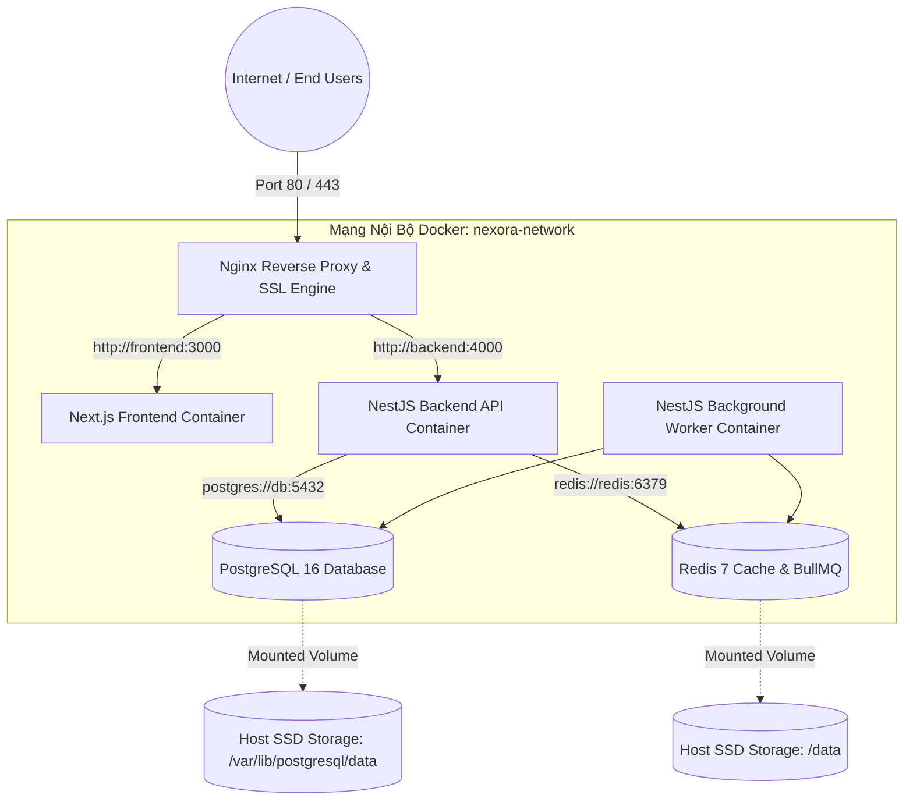
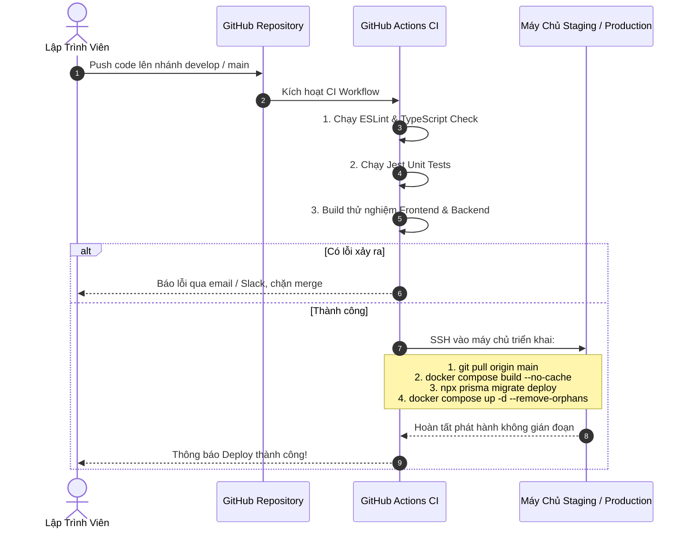

# Kiến Trúc Triển Khai & Vận Hành — Deployment Architecture

> Trạng thái thông tin: `[PROPOSED]` Phương án hạ tầng Docker Compose & Nginx bởi Senior Technical Lead.

Tài liệu này xác định phương án đóng gói, triển khai hạ tầng, thiết lập mạng nội bộ và quy trình tự động hóa phát hành (CI/CD) cho nền tảng **NEXORA**.

---

## 1. Mô Hình Hạ Tầng Triển Khai (Containerized Architecture)

Hệ thống được đóng gói thành các container Docker độc lập, điều phối bằng **Docker Compose** trên một cụm máy chủ ảo (VPS/Cloud Instance):

### Ưu điểm của mô hình Docker Compose:
- **Tối ưu chi phí:** Toàn bộ hệ thống chạy trơn tru trên 1 máy chủ Cloud VPS (cấu hình khuyến nghị: 4 vCPU, 8GB RAM, SSD 100GB) cho giai đoạn đầu, tiết kiệm hàng nghìn USD chi phí cloud so với Kubernetes.
- **Dễ bảo trì & sao lưu:** Khối dữ liệu PostgreSQL và Redis được mount trực tiếp ra ổ đĩa máy chủ ngoài container, đảm bảo không bao giờ mất dữ liệu khi container khởi động lại hoặc nâng cấp mã nguồn.
- **Đồng nhất môi trường:** Cấu hình chạy trên máy chủ Staging và Production hoàn toàn tương thích với môi trường phát triển cục bộ của lập trình viên.

---

## 2. Cấu Hình Nginx Reverse Proxy & Định Tuyến Tên Miền

Nginx đóng vai trò tiếp nhận toàn bộ lưu lượng cổng 80/443 từ internet:
- **Tự động chuyển hướng:** 100% yêu cầu HTTP (Port 80) được chuyển hướng sang HTTPS (Port 443).
- **Định tuyến Frontend:** Mọi yêu cầu truy cập giao diện thông thường được chuyển tiếp về `frontend:3000`.
- **Định tuyến Backend API:** Mọi yêu cầu có tiền tố `/api/*` hoặc `/swagger` được chuyển tiếp về `backend:4000`.
- **Định tuyến WebSocket:** Các kết nối `/socket.io/*` được Nginx thiết lập header `Upgrade $http_upgrade` và `Connection "upgrade"` để duy trì kết nối thời gian thực ổn định.
- **Nén Gzip:** Nén toàn bộ tài nguyên tĩnh (JS, CSS, HTML, JSON) giảm 70% dung lượng truyền tải.

---

## 3. Quy Trình Tự Động Hóa Phát Hành (CI/CD Pipeline)

Quy trình phát hành tự động qua GitHub Actions:

---

## 4. Giám Sát Hệ Thống & Kiểm Tra Sức Khỏe (Healthchecks)

- Cả Frontend và Backend đều cung cấp endpoint kiểm tra trạng thái:
  - Frontend: `GET /api/health`
  - Backend: `GET /api/v1/health` (kiểm tra trạng thái kết nối PostgreSQL và Redis).
- Docker Compose cấu hình `healthcheck` tự động khởi động lại container nếu sau 3 lần kiểm tra liên tiếp không nhận được phản hồi HTTP 200.
