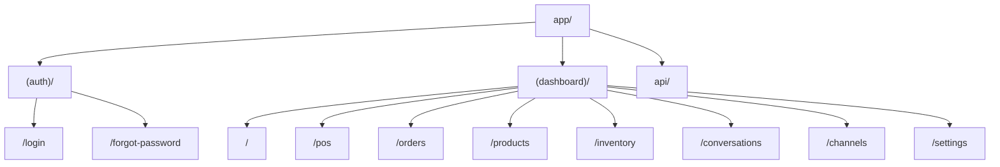

# Kiến Trúc Giao Diện Người Dùng — Frontend Architecture

> Trạng thái thông tin: `[PROPOSED]` Định hướng kiến trúc Next.js App Router bởi Senior Technical Lead.

Tài liệu này xác định các tiêu chuẩn kiến trúc cho ứng dụng giao diện phía người dùng của **NEXORA**, được xây dựng trên nền tảng **Next.js (App Router)**, **React 19**, **TypeScript** và **Tailwind CSS / shadcn/ui**.

---

## 1. Phân Tách Tuyến Đường Ứng Dụng (Route Groups Strategy)

Next.js App Router sử dụng quy ước thư mục trong ngoặc tròn `()` để gom nhóm các tuyến đường mà không làm ảnh hưởng đến đường dẫn URL thực tế:



- **Nhóm `(auth)/`**: Sử dụng bố cục tối giản (Auth Layout), không có thanh điều hướng bên (Sidebar), tối ưu cho tác vụ đăng nhập và khôi phục mật khẩu.
- **Nhóm `(dashboard)/`**: Sử dụng bố cục quản trị toàn diện (Dashboard Layout), bao gồm Sidebar điều hướng, Header chứa bộ chuyển đổi Tenant (Tenant Switcher), thông báo hệ thống và menu người dùng.

---

## 2. Chiến Lược Server Components vs. Client Components

Để đạt hiệu năng tải trang tối ưu và giảm thiểu dung lượng file JavaScript gửi xuống trình duyệt, dự án áp dụng quy tắc phân bổ nghiêm ngặt:

| Thành Phần | Loại Component | Lý Do Sử Dụng |
| :--- | :--- | :--- |
| **Bố cục khung (Layouts)** | React Server Component (RSC) | Render cố định trên máy chủ, tối ưu kích thước bundle, bảo mật cấu hình. |
| **Bảng dữ liệu tĩnh (Tables shell)** | React Server Component (RSC) | Render khung bảng và tiêu đề từ máy chủ. |
| **Màn hình bán hàng (POS Screen)** | Client Component (`'use client'`) | Yêu cầu tương tác cao, lắng nghe sự kiện quét mã vạch, quản lý giỏ hàng trong bộ nhớ máy khách. |
| **Hộp thư hội thoại (Unified Inbox)**| Client Component (`'use client'`) | Kết nối WebSocket (Socket.IO) để nhận tin nhắn mới và cập nhật trạng thái trò chuyện theo thời gian thực. |
| **Biểu mẫu nhập liệu (Forms)** | Client Component (`'use client'`) | Xử lý validation tức thời qua `react-hook-form` và `zod`. |

---

## 3. Kiến Trúc Quản Lý Dữ Liệu & Server State

```mermaid
graph LR
    subgraph Browser_Client [Trình Duyệt Người Dùng]
        UI[UI Components]
        ZustandStore[Zustand Store<br/>(UI State: Sidebar collapse, Active Tab)]
        QueryClient[TanStack Query Cache<br/>(Server State: Orders, Products, Chat)]
    end

    subgraph Backend_Gateway [Máy Chủ NestJS]
        REST[REST API Endpoints]
        WS[Socket.IO Gateway]
    end

    UI -->|Đọc/Ghi UI State| ZustandStore
    UI -->|useQuery / useMutation| QueryClient
    QueryClient <-->|HTTP Requests / Axios Client| REST
    UI <-->|WebSocket Events| WS
    WS -.->|Invalidate Query / Direct State Push| QueryClient
```

- **Server State (TanStack Query):** Toàn bộ dữ liệu nghiệp vụ (danh sách đơn hàng, sản phẩm, tồn kho) được quản lý qua TanStack Query. Dữ liệu được tự động lưu bộ nhớ đệm (cache), hủy tính hợp lệ (invalidation) khi có mutation và cập nhật tức thì.
- **Client UI State (Zustand):** Chỉ sử dụng Zustand cho các trạng thái giao diện cục bộ thuần túy như: Thu phóng thanh Sidebar, bộ lọc giao diện đang chọn, hoặc cài đặt hiển thị bảng.
- **API Client Layer (`lib/api-client.ts`):** Tạo lớp bao bọc Axios hoặc Fetch chuẩn, tự động đính kèm `Authorization: Bearer <token>` và `X-Tenant-ID` vào mọi yêu cầu; tự động xử lý làm mới Access Token khi gặp lỗi HTTP 401.

---

## 4. Hệ Thống Thiết Kế Giao Diện (Design System & shadcn/ui)

- **Nguyên tắc đồng bộ:** Sử dụng hệ màu sắc thương mại chuyên nghiệp (Neutral slate/zinc kết hợp xanh biển primary và điểm nhấn cam/hổ phách cảnh báo).
- **Tránh trùng lặp code:** Mọi nút bấm, hộp thoại, menu thả xuống, bảng dữ liệu đều được kế thừa từ thư mục `components/ui/` do `shadcn/ui` khởi tạo và chuẩn hóa.
- **Đa kích thước màn hình (Responsive):** Màn hình POS được tối ưu hóa cho màn hình cảm ứng máy tính bảng và màn hình máy tính bàn thu ngân; Dashboard thích ứng tốt từ laptop đến màn hình siêu rộng.
