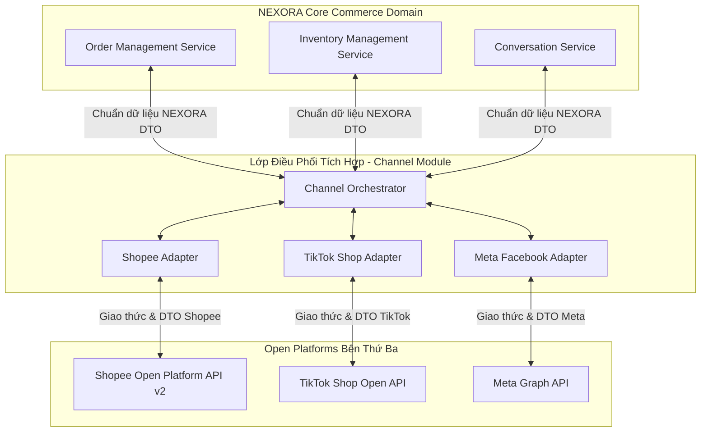
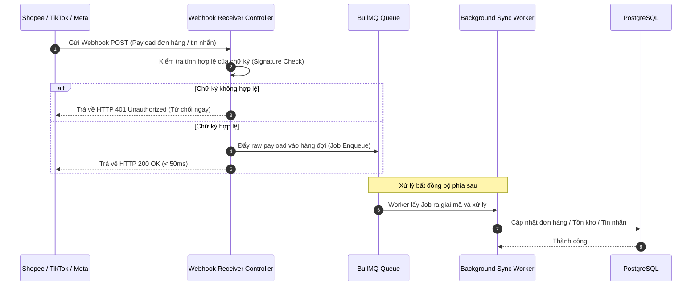

# Kiến Trúc Tích Hợp Đa Kênh — Integration Architecture

> Trạng thái thông tin: `[PROPOSED]` Khung kiến trúc tích hợp hệ thống bên thứ ba bởi Senior Technical Lead.

Tài liệu này xác định nguyên lý thiết kế và mô hình kiến trúc điều phối tích hợp giữa **NEXORA** và các nền tảng thương mại điện tử lớn (Shopee, TikTok Shop, Meta/Facebook) cùng các đơn vị vận chuyển và thanh toán.

---

## 1. Nguyên Tắc Cốt Lõi: Độc Lập Hóa Khối Tích Hợp (Adapter Pattern)

Mỗi nền tảng bên ngoài có cấu trúc dữ liệu, cơ chế xác thực và mã lỗi hoàn toàn khác nhau. Để ngăn chặn việc logic đặc thù của Shopee hay TikTok Shop làm ô nhiễm tầng nghiệp vụ cốt lõi, NEXORA áp dụng mẫu thiết kế **Adapter Pattern**:

Mỗi Adapter chịu trách nhiệm:
1. Chuyển đổi dữ liệu chuẩn của NEXORA thành định dạng yêu cầu của sàn và ngược lại.
2. Quản lý việc ký chữ ký điện tử (HMAC-SHA256 signature).
3. Bắt và chuẩn hóa các mã lỗi đặc thù của sàn thành lỗi chuẩn của hệ thống.

---

## 2. Kiến Trúc Tiếp Nhận Webhook Tốc Độ Cao (Asynchronous Webhook Ingestion)

Các sàn TMĐT như Shopee, TikTok Shop và Facebook yêu cầu máy chủ nhận Webhook phải phản hồi mã `HTTP 200 OK` trong vòng tối đa **2 đến 3 giây**, nếu không sàn sẽ đánh dấu Webhook thất bại và ngừng gửi hoặc gửi lại ồ ạt gây nghẽn máy chủ.

Do đó, NEXORA áp dụng kiến trúc **Nhận Ngay — Xử Lý Sau (Ingest Fast, Process Later)**:

---

## 3. Cơ Chế Kiểm Soát Tần Suất & Chống Quá Tải (Rate Limiting & Circuit Breaker)

- **Rate Limiting:** Mỗi sàn TMĐT đều áp đặt giới hạn tần suất gọi API (ví dụ: Shopee giới hạn số request/giây trên mỗi đối tác). BullMQ Queue của NEXORA được cấu hình thông số `limiter: { max: 10, duration: 1000 }` để đảm bảo hệ thống không bao giờ gọi vượt ngưỡng cho phép của sàn.
- **Circuit Breaker:** Khi phát hiện API của một sàn TMĐT bị lỗi liên tiếp 10 lần (trả về 5xx), hệ thống tạm thời ngắt kết nối trong 60 giây để tránh làm cạn kiệt tài nguyên mạng và thông báo trạng thái "Kênh tạm thời gián đoạn" lên giao diện người dùng.
- **Exponential Backoff:** Các job thất bại do lỗi tạm thời (Timeout, mạng chập chờn) sẽ được tự động xếp lịch thử lại sau: 2s -> 4s -> 8s -> 16s -> 32s trước khi ghi nhận thất bại vĩnh viễn và tạo cảnh báo cho nhân viên vận hành.
