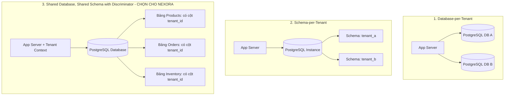
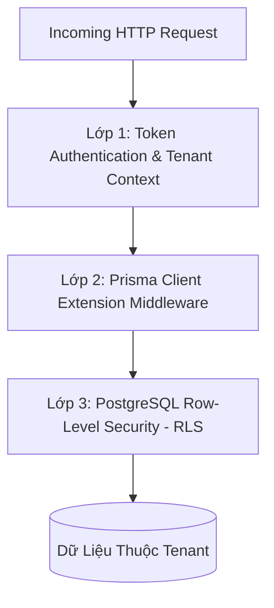

# Chiến Lược Phân Tách Dữ Liệu Đa Doanh Nghiệp — Multi-Tenant Architecture

> Trạng thái thông tin: `[PROPOSED]` Thiết kế kiến trúc phân tách Multi-Tenancy bởi Solution Architect.

Tài liệu này xác định phương án kỹ thuật cách ly dữ liệu giữa các doanh nghiệp (Tenants) trên nền tảng **NEXORA**, đảm bảo an toàn tuyệt đối, ngăn ngừa triệt để rủi ro rò rỉ dữ liệu chéo (Cross-Tenant Data Leakage) nhưng vẫn tối ưu hóa chi phí vận hành máy chủ cơ sở dữ liệu.

---

## 1. So Sánh & Lựa Chọn Mô Hình Multi-Tenancy

Trong kiến trúc SaaS cơ sở dữ liệu quan hệ, có 3 mô hình phổ biến:



### Lý do lựa chọn Mô hình 3 (Shared Schema with Discriminator Column):
1. **Khả năng mở rộng quy mô lớn (Scalability):** Hệ thống có thể hỗ trợ hàng nghìn doanh nghiệp nhỏ và vừa (SMBs) trên cùng một cụm PostgreSQL mà không gặp giới hạn số lượng file descriptor hoặc áp lực quản lý hàng nghìn schemas/databases độc lập.
2. **Chi phí hạ tầng tối thiểu:** Phù hợp hoàn hảo cho giai đoạn khởi nghiệp của khách hàng hiện tại và các doanh nghiệp bán lẻ quy mô nhỏ.
3. **Quy trình di trú dữ liệu đơn giản (Easy Migrations):** Khi nâng cấp Prisma schema, một lệnh migration duy nhất sẽ cập nhật toàn bộ hệ thống ngay lập tức mà không phải chạy lặp qua từng schema riêng biệt.

---

## 2. Cơ Chế Bảo Vệ Đa Lớp (Defense-in-Depth Isolation)

Để triệt tiêu hoàn toàn rủi ro người dùng thuộc Tenant A xem hoặc sửa dữ liệu của Tenant B, NEXORA áp dụng **3 lớp phòng vệ độc lập**:



### Lớp 1: Tenant Context Injection (Application Layer)
- Mỗi Access Token (JWT) được ký chứa claim bất biến `tenant_id`.
- `TenantInterceptor` trích xuất `tenant_id` từ token hợp lệ và lưu vào `AsyncLocalStorage` (Node.js request context).
- Mọi hàm Service khi thực thi đều tự động lấy `tenant_id` hiện tại từ ngữ cảnh này mà không cần phụ thuộc vào tham số do client truyền lên qua query param hay body (loại trừ nguy cơ giả mạo tham số).

### Lớp 2: Prisma Client Extension Filter (ORM Layer)
- Tận dụng tính năng `$extends` của Prisma Client để tự động can thiệp vào các phương thức `findMany`, `findFirst`, `update`, `delete`:
  ```typescript
  // Minh họa cơ chế tự động tiêm tenant_id trong Prisma Extension
  query: {
    $allModels: {
      async $allOperations({ model, operation, args, query }) {
        if (isTenantScopedModel(model)) {
          const tenantId = TenantContext.getTenantId();
          args.where = { ...args.where, tenantId };
        }
        return query(args);
      },
    },
  }
  ```
- Lập trình viên không phải nhớ thêm `where: { tenantId }` bằng tay trong từng câu lệnh truy vấn, hạn chế 100% lỗi do quên sót của con người.

### Lớp 3: PostgreSQL Row-Level Security - RLS (Database Native Layer)
- Kích hoạt chính sách Row-Level Security tại tầng PostgreSQL cho tất cả các bảng dữ liệu nghiệp vụ:
  ```sql
  ALTER TABLE orders ENABLE ROW LEVEL SECURITY;
  CREATE POLICY tenant_isolation_policy ON orders
    FOR ALL
    USING (tenant_id = current_setting('app.current_tenant_id', true));
  ```
- Trước khi thực hiện transaction, backend thiết lập biến cấu hình phiên làm việc: `SET LOCAL app.current_tenant_id = 'tenant-uuid'`. Ngay cả khi câu lệnh SQL thô vô tình bị lỗi sót điều kiện WHERE, PostgreSQL vẫn từ chối trả về dòng dữ liệu không thuộc Tenant đó.

---

## 3. Định Tuyến & Nhận Diện Tenant (Tenant Identification)

Hệ thống hỗ trợ 2 cơ chế nhận diện Tenant:
1. **Định danh qua Subdomain / Slug:** Người dùng truy cập `https://cuahanggiadung.nexora.vn` -> Hệ thống trích xuất `cuahanggiadung` và nạp cấu hình thương hiệu, logo riêng.
2. **Định danh qua Custom Header / Token Payload:** Trong các lệnh gọi REST API từ máy quầy POS hoặc mobile, hệ thống ưu tiên đọc `tenant_id` được mã hóa bên trong chữ ký bảo mật của JWT Token.
