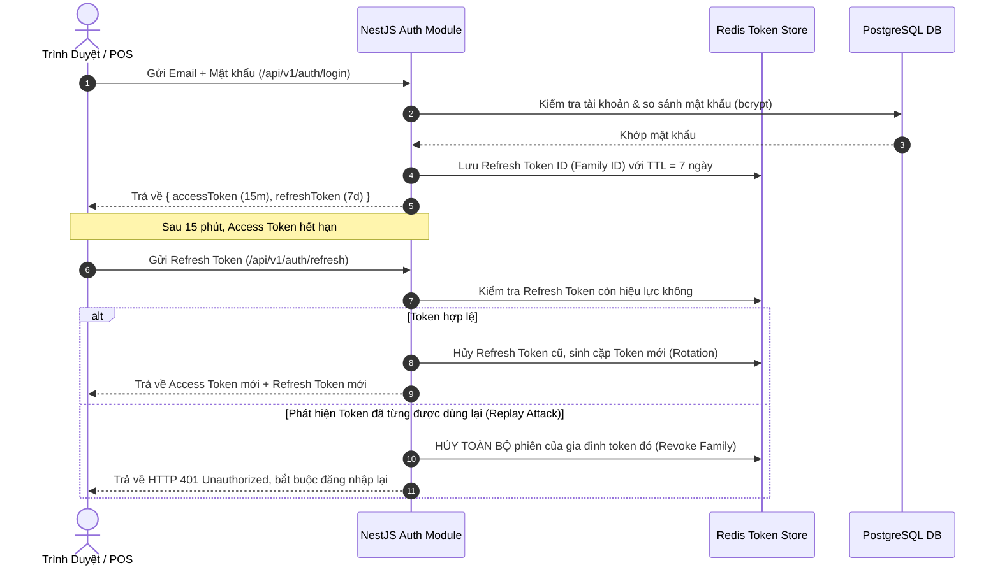

# Chính Sách & Kiến Trúc Bảo Mật — Security Architecture

> Trạng thái thông tin: `[PROPOSED]` Tiêu chuẩn bảo mật bởi Solution Architect.

Tài liệu này xác định các chính sách an toàn thông tin, bảo mật danh tính, mã hóa dữ liệu và phòng chống tấn công mạng cho toàn bộ nền tảng **NEXORA**.

---

## 1. Xác Thực Danh Tính & Vòng Đời Token (Authentication Lifecycle)

NEXORA triển khai mô hình xác thực dựa trên chuẩn JSON Web Token (JWT) kết hợp cơ chế luân chuyển Refresh Token (Refresh Token Rotation):

---

## 2. Kiểm Soát Phân Quyền Vai Trò (RBAC Enforcement)

- **Guards phân tầng:**
  - `JwtAuthGuard`: Xác thực tính toàn vẹn của token qua chữ ký RSA hoặc HMAC SHA-256.
  - `RolesGuard`: Đối chiếu vai trò của người dùng với metadata `@Roles('STORE_MANAGER', 'TENANT_ADMIN')` tại từng endpoint API.
  - `PermissionsGuard`: Đối chiếu quyền hạn chi tiết `@RequirePermissions('orders:delete')` để đảm bảo phân quyền sâu đến từng hành vi.

---

## 3. Mã Hóa & Lưu Trữ Dữ Liệu An Toàn

1. **Mã hóa dữ liệu lưu trữ (Encryption at Rest):**
   - Mật khẩu: Băm một chiều bằng `bcrypt` (Salt rounds = 10).
   - Khóa bí mật tích hợp (App Secret / Access Token của Shopee, TikTok, Facebook): Được mã hóa đối xứng bằng thuật toán `AES-256-GCM` trước khi lưu vào bảng `channel_connections`. Khóa mã hóa (Master Encryption Key) được nạp từ biến môi trường của hệ thống.
2. **Mã hóa đường truyền (Encryption in Transit):**
   - 100% lưu lượng truy cập qua internet bắt buộc chạy trên HTTPS (TLS 1.3).
   - Nginx cấu hình chứng chỉ SSL/TLS tự động qua Let's Encrypt với giao thức HSTS (HTTP Strict Transport Security) được kích hoạt.

---

## 4. Phòng Chống Tấn Công Phổ Biến (OWASP Top 10 Defenses)

| Loại Tấn Công | Giải Pháp Phòng Vệ Trong NEXORA |
| :--- | :--- |
| **SQL Injection** | Tuyệt đối không ghép chuỗi SQL thô; sử dụng 100% Prisma ORM với parameterized queries tự động. |
| **Cross-Site Scripting (XSS)** | React tự động escape HTML khi render; cấu hình Content Security Policy (CSP) headers qua Helmet middleware. |
| **Cross-Site Request Forgery (CSRF)**| API được thiết kế theo kiến trúc Stateless, lưu JWT trong Header `Authorization: Bearer` thay vì cookie thông thường, tự nhiên miễn nhiễm với CSRF. |
| **Brute Force Login** | Giới hạn tần suất gọi API (Rate Limiting) bằng `ThrottlerModule` của NestJS: tối đa 5 lần thử đăng nhập sai trong 1 phút cho một địa chỉ IP. |
| **DDoS & Lạm dụng tài nguyên** | Nginx thiết lập giới hạn `limit_req_zone` tối đa 30 requests/giây cho mỗi IP; các API tải nặng được bảo vệ bởi hàng đợi. |

---

## 5. Nhật Ký Kiểm Toán (Audit Logging)

Hệ thống tự động ghi vết mọi thao tác quan trọng vào bảng `audit_logs` phục vụ điều tra và đối soát nội bộ:
- **Thông tin ghi nhận:** `tenant_id`, `user_id`, `ip_address`, `user_agent`, `action` (ví dụ: `ORDER_CANCELLED`, `PRICE_UPDATED`), `entity_type`, `entity_id`, `before_state` (JSON), `after_state` (JSON), `timestamp`.
