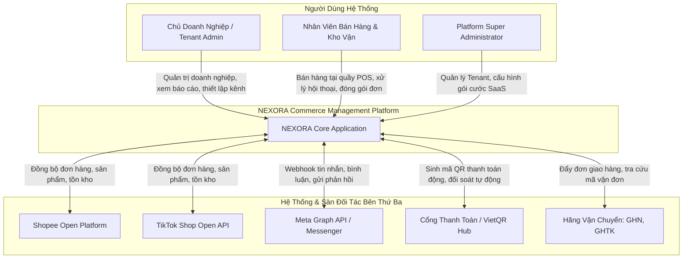
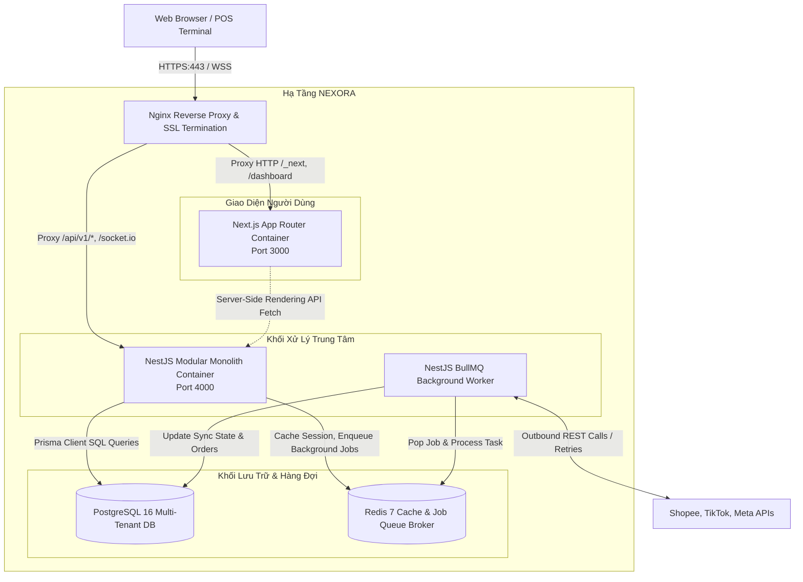

# Tổng Quan Hệ Thống — System Overview & C4 Diagrams

> Trạng thái thông tin: `[PROPOSED]` Mô hình hóa kiến trúc theo chuẩn C4 (Context & Container).

Tài liệu này sử dụng mô hình C4 để biểu diễn bức tranh toàn cảnh về cách các thành phần trong hệ thống NEXORA tương tác với người dùng và các nền tảng bên ngoài.

---

## 1. C4 Cấp Độ 1: System Context Diagram (Bối Cảnh Hệ Thống)

Sơ đồ thể hiện hệ thống NEXORA trong mối quan hệ với các nhóm tác nhân người dùng và hệ thống đối tác bên thứ ba:

---

## 2. C4 Cấp Độ 2: Container Diagram (Kiến Trúc Thành Phần Container)

Sơ đồ phân rã hệ thống NEXORA thành các container phần mềm cụ thể và các kênh giao tiếp:

---

## 3. Dòng Chảy Dữ Liệu Cốt Lõi (Key Data Flows)

1. **Truy vấn đọc/ghi thông thường (Synchronous HTTP):** Client gửi yêu cầu -> Nginx định tuyến đến NestJS -> `TenantInterceptor` gắn ngữ cảnh `tenant_id` -> Service xử lý nghiệp vụ -> Prisma truy vấn PostgreSQL -> Trả kết quả JSON về cho Frontend render.
2. **Sự kiện thời gian thực (Realtime WebSocket):** Tin nhắn mới từ Facebook/TikTok về Webhook -> NestJS xác thực -> Phát qua `Socket.IO Gateway` -> Trình duyệt của nhân viên trực chat tự động hiển thị tin nhắn mới mà không cần F5 tải lại trang.
3. **Đồng bộ tải nặng (Asynchronous Queue):** Webhook đơn hàng hoặc yêu cầu đẩy tồn kho hàng loạt -> NestJS đẩy vào hàng đợi Redis BullMQ -> Trả về HTTP 200 ngay lập tức -> Worker tiến hành xử lý ngầm và cập nhật trạng thái vào PostgreSQL.
