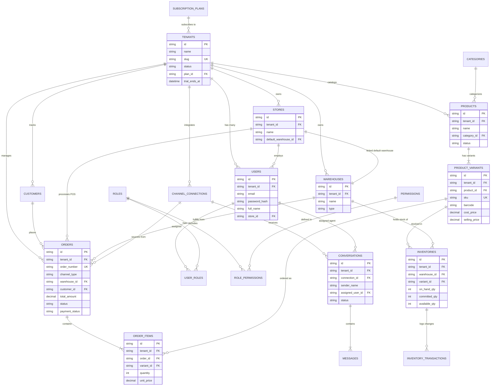

# Sơ Đồ Quan Hệ Thực Thể — Entity Relationship Diagram (ERD)

> Trạng thái thông tin: `[PROPOSED]` Mô hình thực thể cơ sở dữ liệu quan hệ được trực quan hóa bằng Mermaid ER Diagram.

Tài liệu này thể hiện toàn bộ quan hệ ràng buộc (Foreign Keys, Quan hệ 1-n, n-n) giữa các thực thể trong nền tảng **NEXORA**.

---

## 1. Sơ Đồ ERD Tổng Thể Hệ Thống

---

## 2. Các Mối Quan Hệ Nghiệp Vụ Trọng Điểm

1. **Phân cấp Tổ chức: `Tenant -> Store -> Warehouse`**
   - Một `Tenant` sở hữu nhiều `Store` và nhiều `Warehouse`.
   - Mỗi `Store` được liên kết với một `Warehouse` mặc định để phục vụ trừ kho tức thì khi bán hàng tại quầy POS.
2. **Quản lý Hàng Hóa: `Product -> ProductVariant -> Inventory`**
   - Sản phẩm cha (`Product`) chỉ chứa thông tin chung (tên, danh mục, thương hiệu, mô tả).
   - Biến thể (`ProductVariant`) chứa thông tin kinh doanh cụ thể (SKU, barcode, giá vốn, giá bán).
   - Tồn kho (`Inventory`) là bảng trung gian liên kết giữa `ProductVariant` và `Warehouse` theo quan hệ n-n, đảm bảo theo dõi chính xác số lượng của từng biến thể tại từng kho riêng biệt.
3. **Đơn Hàng Đa Kênh: `ChannelConnection -> Order -> OrderItem`**
   - Mỗi đơn hàng đều ghi nhận `channel_type` (Shopee, TikTok, POS, Facebook) và liên kết đến kho xuất hàng `warehouse_id`.
