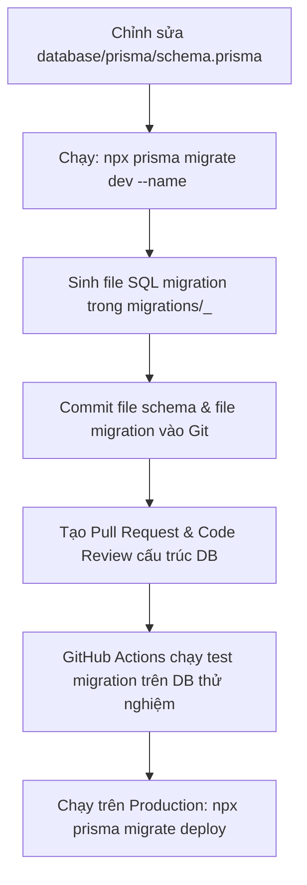

# Chiến Lược Di Trú Dữ Liệu & Nâng Cấp Schema — Migration Strategy

> Trạng thái thông tin: `[PROPOSED]` Quy trình Prisma Migrations & Zero-Downtime Deployment bởi Senior Technical Lead.

Tài liệu này xác định quy trình nâng cấp cấu trúc cơ sở dữ liệu từ môi trường phát triển (Development) đến môi trường thực tế (Production) của **NEXORA**.

---

## 1. Quy Trình Vòng Đời Migration với Prisma

### Các nguyên tắc bắt buộc:
1. **Không sửa file migration đã được merge:** Một khi file migration đã được merge vào nhánh chính (`develop` hoặc `main`), tuyệt đối không được phép chỉnh sửa nội dung file SQL đó. Mọi thay đổi tiếp theo phải tạo một migration mới.
2. **Không chạy `prisma db push` trên Production:** Lệnh `prisma db push` chỉ dùng để thử nghiệm nhanh ở môi trường local; môi trường Production bắt buộc phải chạy `npx prisma migrate deploy` để đảm bảo lịch sử nâng cấp được ghi nhận đầy đủ vào bảng `_prisma_migrations`.

---

## 2. Chiến Lược Nâng Cấp Không Gián Đoạn (Zero-Downtime Database Migration)

Khi hệ thống đã có hàng triệu đơn hàng và hàng nghìn người dùng đang giao dịch trực tuyến, việc khóa bảng (Table Locking) để đổi tên cột hoặc xóa cột có thể làm sập dịch vụ. NEXORA áp dụng chiến lược **Expand and Contract (Mở rộng trước — Thu hẹp sau)**:

### Ví dụ: Đổi tên trường `phone` thành `phone_number` trong bảng `stores`
- **Bước 1 (Expand - Mở rộng):**
  - Tạo cột mới `phone_number VARCHAR(20) NULL`.
  - Giữ nguyên cột cũ `phone`.
  - Triển khai code backend mới: Ghi dữ liệu đồng thời vào cả 2 cột `phone` và `phone_number`, đọc dữ liệu ưu tiên từ `phone_number` (nếu null thì đọc `phone`).
- **Bước 2 (Backfill - Nạp dữ liệu cũ):**
  - Chạy kịch bản SQL ngầm: `UPDATE stores SET phone_number = phone WHERE phone_number IS NULL;`.
- **Bước 3 (Contract - Thu hẹp):**
  - Triển khai code backend loại bỏ hoàn toàn việc tham chiếu đến cột cũ `phone`.
  - Tạo migration xóa bỏ cột cũ: `ALTER TABLE stores DROP COLUMN phone;`.

---

## 3. Quy Chuẩn Nạp Dữ Liệu Mẫu (Database Seeding)

Hệ thống phân tách seed data thành 2 cấp độ rõ ràng:
- **Seed Production (`database/seeds/prod/`):**
  - Chỉ nạp các bảng danh mục bắt buộc để hệ thống vận hành: Danh mục quyền hạn (`permissions`), Gói cước (`subscription_plans`), Tài khoản Super Admin mặc định.
- **Seed Development (`database/seeds/dev/`):**
  - Nạp dữ liệu giả lập phong phú cho môi trường dev: 1 Tenant mẫu ("Gia Dụng Hiện Đại"), 2 Cửa hàng, 3 Kho hàng, 50 sản phẩm đồ gia dụng có biến thể, 100 đơn hàng mẫu ở các trạng thái khác nhau và 20 cuộc hội thoại chat.
  - Được kích hoạt qua lệnh: `pnpm run seed:dev`.
