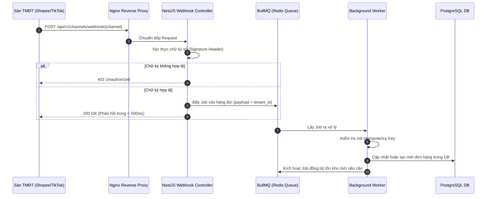

# Kiến trúc tích hợp hệ thống bên ngoài (Integrations Architecture)

> Trạng thái thông tin: `[PROPOSED]` Khung kiến trúc tích hợp kênh bán, giao vận và thanh toán.

Tài liệu này xác lập các nguyên tắc và hạ tầng kỹ thuật phục vụ việc kết nối nền tảng NEXORA với các đối tác bên thứ ba bao gồm sàn thương mại điện tử (Shopee, TikTok Shop), nền tảng mạng xã hội (Meta), đơn vị vận chuyển (GHTK, GHN, Viettel Post) và cổng thanh toán (VietQR).

## 1. Các nguyên tắc tích hợp then chốt

1. **Xử lý bất đồng bộ qua hàng đợi (Asynchronous by Default)**: Mọi thao tác kết nối mạng ra bên ngoài có độ trễ lớn hoặc rủi ro gián đoạn đều phải đưa vào hàng đợi BullMQ lưu trữ trên Redis. Không thực hiện gọi API bên thứ ba trực tiếp trong chu trình xử lý HTTP Request của người dùng.
2. **Tính lũy đẳng khi nhận Webhook (Idempotency)**: Các sàn thương mại điện tử có thể gửi lại cùng một Webhook sự kiện nhiều lần. Hệ thống lưu mã định danh sự kiện (`event_id` hoặc `order_sn`) vào Redis trong 24 giờ. Nếu mã đã tồn tại, hệ thống trả về mã trạng thái HTTP `200 OK` ngay lập tức và bỏ qua bước xử lý lặp lại.
3. **Tuân thủ giới hạn tần suất (Rate Limiting)**: Mỗi nền tảng có một hạn ngạch tần suất gọi API riêng. Bộ điều phối Worker phải kiểm tra token bucket trước khi thực hiện cuộc gọi để tránh bị khóa tài khoản API tạm thời.
4. **Bảo mật lưu trữ khóa ủy quyền**: Toàn bộ Access Token, Refresh Token và App Secret của từng gian hàng phải được mã hóa trước khi lưu vào cơ sở dữ liệu bằng thuật toán AES-256-GCM.

## 2. Sơ đồ luồng xử lý Webhook từ sàn

## 3. Danh mục các tài liệu tích hợp chuyên sâu

- [**FACEBOOK.md**](./FACEBOOK.md): Meta Graph API, Webhook Messenger, chính sách cửa sổ 24 giờ.
- [**TIKTOK_SHOP.md**](./TIKTOK_SHOP.md): TikTok Shop Open API, xác thực chữ ký và xử lý đơn hàng.
- [**SHOPEE.md**](./SHOPEE.md): Shopee Open Platform API v2, tính toán HMAC-SHA256 và phân trang đơn.
- [**SHIPPING.md**](./SHIPPING.md): Kết nối API các đơn vị vận chuyển nội địa (GHTK, GHN, Viettel Post).
- [**PAYMENT.md**](./PAYMENT.md): Cổng thanh toán chuyển khoản tự động và quét mã VietQR động.
