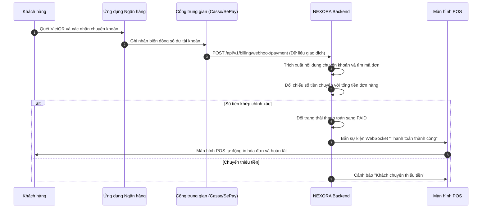

# Tích hợp cổng thanh toán và VietQR (Payment Gateways & VietQR Integration)

> Trạng thái thông tin: `[CONFIRMED]` cho chuyển khoản qua mã VietQR động | `[PROPOSED]` cho đối soát biến động số dư tự động qua Webhook ngân hàng.

Tài liệu này hướng dẫn cách thức tích hợp phương thức thanh toán chuyển khoản ngân hàng tự động bằng mã QR chuẩn quốc gia (VietQR) và các cổng thanh toán số trên nền tảng NEXORA.

## 1. Phương thức thanh toán chủ đạo

NEXORA ưu tiên phương thức thanh toán bằng mã **VietQR động** cho cả hai bài toán:
1. **Thanh toán tại quầy bán lẻ (POS)**: Khách hàng mua đồ gia dụng tại 2 cửa hàng vật lý có thể quét mã QR hiển thị trên màn hình phụ để thanh toán trong 3 giây.
2. **Thanh toán gia hạn gói cước SaaS**: Chủ doanh nghiệp quét mã QR để gia hạn phần mềm với số tiền và nội dung chuyển khoản được mã hóa chính xác tuyệt đối.

## 2. Tiêu chuẩn cấu trúc mã VietQR động

Mã VietQR tuân theo tiêu chuẩn quốc tế EMVCo QRCode do Napas và các ngân hàng thương mại Việt Nam ban hành:

- `Bank BIN`: Mã định danh ngân hàng nhận tiền (Ví dụ: `970422` cho MBBank, `970436` cho Vietcombank).
- `Account Number`: Số tài khoản ngân hàng thụ hưởng của cửa hàng hoặc của nền tảng NEXORA.
- `Amount`: Số tiền chính xác cần thanh toán (Tránh việc khách hàng gõ nhầm số tiền).
- `Description`: Cú pháp nội dung chuyển khoản duy nhất phục vụ đối soát tự động:
  - Cho đơn POS: `NEX POS {order_number}`
  - Cho gia hạn SaaS: `NEX SUB {tenant_slug} {invoice_id}`

Đường dẫn tạo hình ảnh mã QR động nhanh:
`https://img.vietqr.io/image/{bank_bin}-{account_number}-compact2.png?amount={amount}&addInfo={description}&accountName={account_name}`

## 3. Luồng đối soát giao dịch tự động qua Webhook (CASSO / SePay)

Để nhận diện giao dịch chuyển khoản thành công mà không cần nhân viên kiểm tra sao kê bằng tay, hệ thống kết nối với dịch vụ cổng trung gian đọc biến động số dư ngân hàng (Casso hoặc SePay):

## 4. Bảo mật và phòng chống gian lận

- Mọi Webhook thông báo thanh toán gửi từ cổng trung gian bắt buộc phải có mã API Key bí mật đính kèm trong tiêu đề `Secure-Token`.
- Không dựa hoàn toàn vào ảnh chụp màn hình chuyển khoản của khách hàng do nguy cơ làm giả hình ảnh chuyển khoản (Fake Bill). Hệ thống chỉ xác nhận hoàn tất đơn khi máy chủ backend thực sự nhận được Webhook biến động số dư từ ngân hàng.
