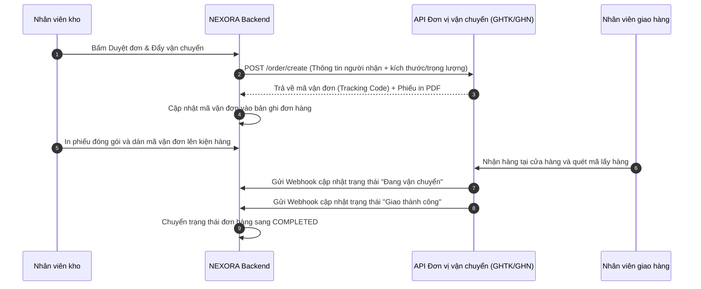

# Tích hợp đơn vị vận chuyển (Shipping Carriers Integration)

> Trạng thái thông tin: `[PROPOSED]` Đặc tả kỹ thuật kết nối giao vận nội địa (GHTK, GHN, Viettel Post).

Tài liệu này hướng dẫn cách kết nối hệ thống NEXORA với các đơn vị vận chuyển hàng hóa nội địa tại Việt Nam, phục vụ việc tự động tạo vận đơn, in phiếu gửi và theo dõi hành trình đơn hàng.

## 1. Danh sách các đối tác vận chuyển hỗ trợ

- **Giao Hàng Tiết Kiệm (GHTK)**: Tích hợp qua REST API v2 với mã Token bảo mật theo tài khoản shop.
- **Giao Hàng Nhanh (GHN)**: Tích hợp qua API v2 với `ShopId` và `Token`.
- **Viettel Post (VTP)**: Tích hợp qua Open API với cơ chế đăng nhập lấy Token phiên làm việc.

## 2. Quy trình xử lý vận đơn tổng thể

## 3. Cấu hình thông số đóng gói hàng gia dụng

Do đặc thù ngành hàng kinh doanh đồ gia dụng (nồi chiên không dầu, ấm siêu tốc, quạt điện) có kích thước lớn và trọng lượng quy đổi cao, hệ thống yêu cầu cấu hình đầy đủ 4 thông số đóng gói trên từng biến thể sản phẩm:

- Trọng lượng kiện hàng (tính bằng gram).
- Chiều dài kiện hàng (tính bằng cm).
- Chiều rộng kiện hàng (tính bằng cm).
- Chiều cao kiện hàng (tính bằng cm).

Công thức tính cước vận chuyển tự động lấy giá trị lớn hơn giữa trọng lượng thực tế và trọng lượng quy đổi thể tích theo chuẩn logistics:
`Trọng lượng thể tích = (Dài x Rộng x Cao) / 5000`

## 4. Xử lý trạng thái đối soát và thu tiền hộ (COD)

- Khi giao hàng có thu hộ tiền mặt (COD), hệ thống lưu số tiền cần thu vào trường `cod_amount`.
- Định kỳ hàng tuần, đơn vị vận chuyển gửi bảng kê đối soát tiền COD đã thu từ người mua. Hệ thống đối chiếu số tiền thực nhận với tổng tiền COD trên các đơn hàng có trạng thái giao thành công để phát hiện các khoản tiền thu thiếu hoặc trừ phí sai lệch.
