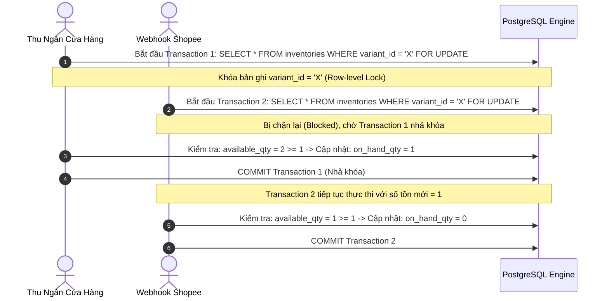

# Phân Hệ Quản Lý Tồn Kho & Kho Hàng — Inventory Management Module

> Trạng thái thông tin: `[CONFIRMED]` cho quản lý tồn kho đa điểm & phiếu chuyển kho | `[PROPOSED]` cho cơ chế khóa đồng thời chống bán âm (Concurrency Lock).

## 1. Mục Đích
Phân hệ Inventory Management chịu trách nhiệm theo dõi chính xác số lượng tồn kho của từng biến thể sản phẩm tại từng kho hàng (Kho Tổng, Kho Cửa Hàng 1, Kho Cửa Hàng 2), quản lý quy trình nhập/xuất/chuyển kho và giải quyết triệt để bài toán xung đột dữ liệu tồn kho đồng thời (Concurrency Lock).

## 2. Phạm Vi Nghiệp Vụ
- Quản lý danh sách kho hàng (`CENTRAL`, `STORE_ATTACHED`).
- Theo dõi 3 trạng thái tồn kho: **Tồn thực tế (On-hand)**, **Đang giữ cho đơn hàng (Committed)**, và **Khả dụng bán (Available)**.
- Quy trình lập phiếu nhập kho từ nhà cung cấp (Purchase Receipt).
- Quy trình điều chuyển hàng giữa các kho (Stock Transfer).
- Kiểm kê kho và lập phiếu điều chỉnh chênh lệch (Inventory Adjustment).
- Ghi nhật ký mọi biến động vào `inventory_transactions`.

## 3. Đối Tượng Sử Dụng
- Tenant Administrator.
- Thủ kho / Nhân viên kho vận (Warehouse Staff).
- Cửa hàng trưởng (Store Manager).

## 4. Các Chức Năng Chính
- **Bảng Điều Khiển Tồn Kho Đa Điểm:** Xem nhanh số lượng tồn của 1 mã SKU tại từng kho hoặc tổng toàn hệ thống.
- **Phiếu Nhập Hàng (Goods Receipt):** Nhập số lượng nhận, giá nhập, tự động tính giá vốn bình quân và cộng vào tồn thực tế.
- **Phiếu Chuyển Kho (Stock Transfer):** Luồng 3 bước: Tạo yêu cầu chuyển -> Kho xuất bấm "Đã xuất hàng" (hàng chuyển sang trạng thái In-Transit) -> Kho nhận kiểm đếm bấm "Đã nhận hàng" (hàng cộng vào kho đích).
- **Cảnh Báo Tồn An Toàn (Reorder Point):** Cảnh báo khi tồn khả dụng giảm xuống dưới ngưỡng tối thiểu thiết lập.

## 5. Quy Tắc Nghiệp Vụ (Business Rules)
- `BR-INV-001`: Công thức tính tồn kho bắt buộc:  
  $$\text{Available Qty} = \text{On-Hand Qty} - \text{Committed Qty}$$
- `BR-INV-002`: Mọi giao dịch làm tăng hoặc giảm số lượng tồn kho bắt buộc phải sinh ra một bản ghi trong `inventory_transactions` (Không bao giờ cập nhật thẳng trường số lượng mà không có nhật ký chứng từ).
- `BR-INV-003`: Mặc định hệ thống KHÔNG cho phép bán âm kho (Available Qty < 0).

---

## 6. Chiến Lược Xử Lý Xung Đột Đồng Thời (Concurrency & Locking Strategy)

Khi có nhiều đơn hàng phát sinh cùng lúc (ví dụ: Thu ngân đang bấm thanh toán tại Cửa hàng 1 trong khi Flash Sale trên Shopee vừa nhận Webhook 5 đơn cho cùng một chiếc nồi chiên không dầu chỉ còn 2 chiếc trong kho), nguy cơ xảy ra tranh chấp dữ liệu (Race Condition) dẫn đến bán vượt tồn (Overselling) là rất lớn.

NEXORA áp dụng chiến lược **Pessimistic Locking (Khóa Bi Quan) kết hợp Database Transaction**:

Nhờ câu lệnh `SELECT ... FOR UPDATE` trong transaction của PostgreSQL:
1. Mọi yêu cầu tranh chấp cùng một biến thể sản phẩm tại một kho bắt buộc phải xếp hàng tuần tự.
2. Tuyệt đối không xảy ra tình trạng đọc sai số lượng tồn ban đầu (Dirty Read hoặc Non-repeatable Read).

---

## 7. Dữ Liệu Liên Quan
- `warehouses`, `inventories`, `inventory_transactions`, `stock_transfers`, `stock_transfer_items`, `product_variants`.

## 8. API Dự Kiến
- `GET /api/v1/inventories`: Tra cứu tồn kho (lọc theo kho, theo SKU).
- `POST /api/v1/inventories/receipts`: Lập phiếu nhập kho.
- `POST /api/v1/inventories/transfers`: Tạo phiếu chuyển kho.
- `PATCH /api/v1/inventories/transfers/{id}/ship`: Xác nhận xuất hàng chuyển kho.
- `PATCH /api/v1/inventories/transfers/{id}/receive`: Xác nhận nhận hàng chuyển kho.
- `POST /api/v1/inventories/adjust`: Lập phiếu kiểm kê điều chỉnh tồn.

## 9. Quyền Truy Cập
- Quyền: `inventory:read`, `inventory:create_receipt`, `inventory:transfer`, `inventory:adjust`.

## 10. Các Trường Hợp Biên (Edge Cases)
- Hàng chuyển kho bị vỡ hỏng dọc đường: Kho nhận chỉ xác nhận nhận số lượng nguyên vẹn (ví dụ nhận 8/10 chiếc); 2 chiếc hư hỏng được hệ thống tự động sinh phiếu xuất hủy hao hụt gắn với mã chuyển kho.

## 11. Tiêu Chí Nghiệm Thu (Acceptance Criteria)
- Hai luồng đồng thời cố gắng mua chiếc nồi chiên cuối cùng -> Chỉ 1 luồng thành công; luồng còn lại nhận lỗi HTTP 409 `ORDER_INSUFFICIENT_STOCK` trong vòng < 100ms.

## 12. Những Điểm Cần Xác Nhận Với Khách Hàng `[UNDECIDED]`
- Phương pháp tính giá vốn hàng tồn kho ưu tiên sử dụng: Bình quân gia quyền (Weighted Average) hay Nhập trước xuất trước (FIFO)?
