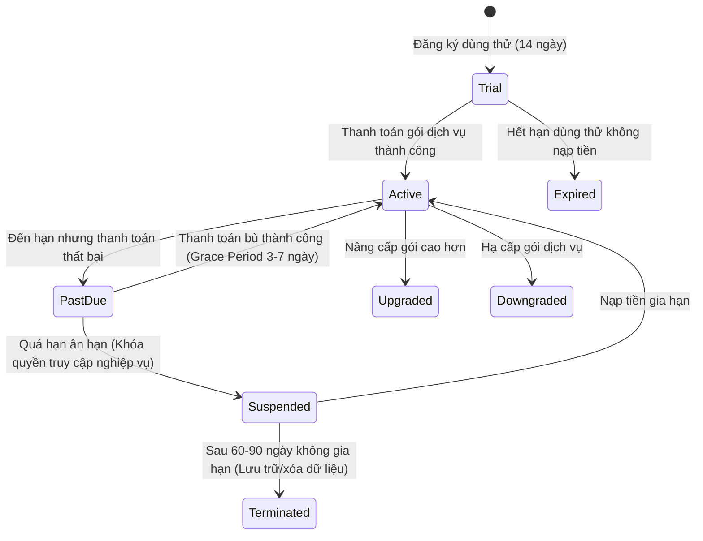

# Mô Hình Kinh Doanh SaaS — Business Model

> Trạng thái thông tin: `[CONFIRMED]` cho định hướng thu phí thuê bao | `[PROPOSED]` cho cơ cấu gói cước | `[UNDECIDED]` cho bảng giá cụ thể.

## 1. Mô Hình Doanh Thu Định Kỳ (SaaS Subscription Model)

NEXORA áp dụng mô hình doanh thu phần mềm dịch vụ đám mây (B2B SaaS) dựa trên chu kỳ thuê bao:
- **Thu phí định kỳ theo tháng (Monthly Recurring Revenue - MRR).**
- **Thu phí định kỳ theo năm (Annual Recurring Revenue - ARR)** với ưu đãi giảm giá (ví dụ: tặng 2 tháng khi thanh toán trọn năm).

---

## 2. Đề Xuất Phân Tầng Gói Dịch Vụ (Tiered Pricing Structure) `[PROPOSED]`

Các gói cước được thiết kế linh hoạt dựa trên quy mô chi nhánh, số lượng kênh tích hợp và số lượng tài khoản nhân sự:

| Tiêu chí | Gói Starter (Khởi Nghiệp) | Gói Growth (Tăng Trưởng) | Gói Enterprise (Chuỗi Lớn) |
| :--- | :--- | :--- | :--- |
| **Phù hợp với** | Hộ kinh doanh cá thể, 1 cửa hàng | Doanh nghiệp bán lẻ (như KH hiện tại: 2-5 cửa hàng) | Chuỗi chuỗi bán lẻ > 5 chi nhánh, quy mô lớn |
| **Số lượng Cửa hàng (Stores)** | Tối đa 1 cửa hàng | Tối đa 3 cửa hàng | Không giới hạn |
| **Số lượng Kho (Warehouses)** | 1 kho đi kèm | Tối đa 3 kho | Không giới hạn |
| **Tài khoản nhân viên (Users)**| Tối đa 3 tài khoản | Tối đa 10 tài khoản | Không giới hạn |
| **Kênh bán hàng kết nối** | 1 kênh sàn (Shopee hoặc TikTok) | Tối đa 5 kênh (Shopee, TikTok, FB Pages) | Không giới hạn |
| **Hộp thư hội thoại tập trung**| Giới hạn 500 hội thoại/tháng | Không giới hạn | Không giới hạn + Phân bổ tự động |
| **Báo cáo chuyên sâu (BI)** | Báo cáo cơ bản | Báo cáo doanh thu & tồn kho chi tiết | Báo cáo tùy chỉnh & xuất dữ liệu tự động |
| **Mức giá dự kiến** `[UNDECIDED]`| *Chờ khách hàng chốt định giá* | *Chờ khách hàng chốt định giá* | *Chờ khách hàng chốt định giá* |

---

## 3. Quản Lý Vòng Đời Doanh Nghiệp Thuê Bao (Tenant Lifecycle)

### 3.1. Giai đoạn Dùng thử (Trial Period) `[PROPOSED]`
- Cung cấp trải nghiệm 14 ngày miễn phí với đầy đủ tính năng của gói Growth để khách hàng kiểm chứng năng lực đồng bộ đơn và chat.

### 3.2. Nâng cấp & Hạ cấp (Upgrade / Downgrade)
- **Nâng cấp gói (Upgrade):** Áp dụng ngay lập tức, tính tiền chênh lệch theo số ngày còn lại của kỳ thanh toán.
- **Hạ cấp gói (Downgrade):** Có hiệu lực vào đầu kỳ thanh toán kế tiếp; hệ thống yêu cầu người dùng tắt bớt kênh hoặc vô hiệu hóa tài khoản vượt quá định mức của gói mới trước khi chuyển đổi.

### 3.3. Xử lý Thanh toán Thất Bại & Khóa Tài Khoản (Dunning & Suspension)
- **Thời gian ân hạn (Grace Period):** Cho phép 3 ngày kể từ khi hết hạn gói để người dùng thanh toán. Trong 3 ngày này, hệ thống vẫn duy trì đồng bộ dữ liệu và hiển thị cảnh báo đỏ trên thanh tiêu đề.
- **Tạm ngưng dịch vụ (Suspension):** Sau 3 ngày, khóa toàn bộ tính năng tạo đơn mới và đồng bộ API; chỉ cho phép Tenant Admin đăng nhập vào trang Thanh toán để gia hạn.

---

## 4. Các Vấn Đề Cần Tiếp Tục Xác Nhận Với Khách Hàng `[UNDECIDED]`

1. Có áp dụng phí thiết lập ban đầu (Setup fee/Onboarding fee) hay không?
2. Có thu phí tiện ích bổ sung (Add-on pricing: thêm 1 cửa hàng = +X vnđ/tháng, thêm 1 kênh sàn = +Y vnđ/tháng) hay bắt buộc nâng cấp trọn gói?
3. Chính sách sao lưu dữ liệu cho Tenant sau khi hủy dịch vụ (giữ lại bao nhiêu ngày trước khi xóa vĩnh viễn)?
