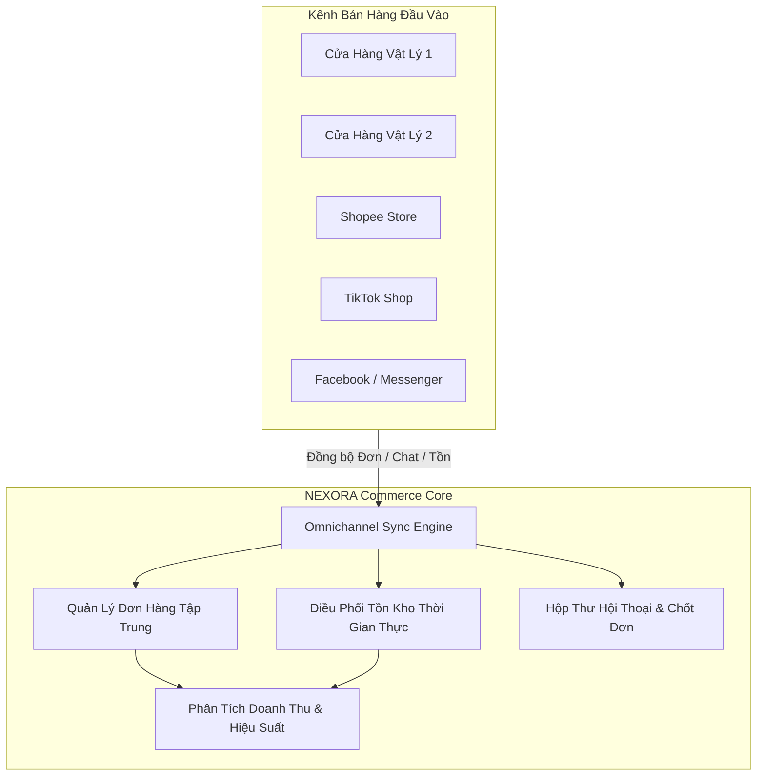

# Tổng Quan Sản Phẩm — NEXORA

> Trạng thái thông tin: `[CONFIRMED]` cho bối cảnh hiện tại | `[PROPOSED]` cho kiến trúc & lộ trình mở rộng.

## 1. Định Vị Sản Phẩm

**Tên dự án:** NEXORA  
**Tên sản phẩm thương mại:** NEXORA — Commerce Management Platform  
**Khẩu hiệu (Tagline):** *"One Platform. Every Channel. Complete Control."*  

NEXORA là giải pháp phần mềm quản trị thương mại hợp nhất (Omnichannel Commerce Management Platform) được thiết kế chuyên biệt cho các doanh nghiệp bán lẻ vừa và nhỏ (SMBs) có mô hình kết hợp cửa hàng truyền thống (Offline) và các kênh bán hàng trực tuyến (Online).

Khác biệt cốt lõi của NEXORA là mô hình **SaaS Multi-Tenant**: Nền tảng cho phép hàng nghìn doanh nghiệp cùng khai thác trên một hạ tầng công nghệ hiện đại, nhưng dữ liệu, cấu hình và hoạt động kinh doanh của từng doanh nghiệp được phân lập và bảo mật tuyệt đối.

---

## 2. Bối Cảnh Khách Hàng Ban Đầu & Vấn Đề Thị Trường

### 2.1. Hiện Trạng Khách Hàng Khởi Đầu `[CONFIRMED]`
- **Ngành hàng:** Kinh doanh thiết bị & đồ gia dụng.
- **Quy mô hiện tại:** 2 cửa hàng vật lý.
- **Kênh bán hàng online:** Facebook (Fanpage/Messenger), TikTok Shop và Shopee.
- **Hiện trạng phần mềm:** Đang thuê giải pháp đóng gói từ một nhà cung cấp bên ngoài (bị hạn chế tính năng tùy biến, chi phí cộng dồn theo kênh, dữ liệu phụ thuộc).
- **Mục tiêu chiến lược:** Tự chủ xây dựng nền tảng quản trị bán hàng của riêng mình, vừa phục vụ vận hành chuỗi cửa hàng gia dụng hiện tại, vừa thương mại hóa dưới dạng giải pháp SaaS thu phí định kỳ cho các doanh nghiệp bán lẻ khác trên thị trường.

### 2.2. Vấn Đề Nhức Nhối Của Thị Trường Bán Lẻ Đa Kênh `[PROPOSED]`
1. **Phân mảnh dữ liệu:** Tồn kho trên Shopee, TikTok Shop và cửa hàng thực tế không đồng bộ kịp thời, dẫn đến tình trạng bán vượt tồn kho (overselling), bị sàn phạt điểm vận hành hoặc hủy đơn hàng loạt.
2. **Quy trình xử lý đơn hàng rời rạc:** Nhân viên phải đăng nhập vào từng kênh riêng lẻ để kiểm tra đơn hàng, in phiếu gửi và đối soát trạng thái giao vận.
3. **Mất khách hàng tiềm năng trên mạng xã hội:** Tin nhắn, bình luận trên Facebook và TikTok bị trôi hoặc phản hồi chậm trễ do thiếu hộp thư tập trung và công cụ tạo đơn trực tiếp ngay trong luồng hội thoại.
4. **Chi phí phần mềm leo thang:** Các phần mềm SaaS hiện hành thường tính phí phụ thu dựa trên số lượng kênh kết nối hoặc phần trăm doanh thu, gây áp lực tài chính lớn cho doanh nghiệp khi mở rộng quy mô.

---

## 3. Giải Pháp Toàn Diện Của NEXORA

NEXORA xóa bỏ rào cản phân mảnh bằng một trung tâm điều hành thống nhất:

---

## 4. Bốn Trụ Cột Năng Lực Cốt Lõi

1. **SaaS Multi-Tenant Management:** Quản trị doanh nghiệp thuê bao, phân quyền linh hoạt theo mô hình `Platform -> Tenant -> Store -> Warehouse`.
2. **Omnichannel Core:** Đồng bộ hai chiều đơn hàng, sản phẩm và tồn kho từ Shopee, TikTok Shop và Facebook; cảnh báo khi tồn kho biến động.
3. **Conversation & Social Commerce:** Gom toàn bộ tin nhắn, bình luận từ các Fanpage Facebook và kênh chat về một giao diện duy nhất, cho phép phân công nhân viên xử lý và tạo đơn hàng ngay trong cuộc trò chuyện.
4. **Point of Sale (POS) & Kho Vận:** Tối ưu hóa tốc độ bán hàng tại quầy cho 2 cửa hàng hiện tại và khả năng mở rộng thêm chuỗi chi nhánh trong tương lai.

---

## 5. Định Hướng Phát Triển Dài Hạn

- **Giai đoạn 1:** Ổn định vận hành nội bộ cho khách hàng khởi đầu (ngành gia dụng, 2 cửa hàng, 3 kênh sàn).
- **Giai đoạn 2:** Đóng gói sản phẩm thương mại SaaS (Self-service Onboarding, cổng thanh toán tự động, bảng giá dịch vụ).
- **Giai đoạn 3:** Mở rộng hệ sinh thái tích hợp (kết nối mở rộng Lazada, Tiki, các đơn vị vận chuyển hàng đầu GHTK, GHN, Viettel Post).
- **Giai đoạn 4:** Nâng cấp trí tuệ nhân tạo gợi ý nhập hàng và tự động phản hồi hội thoại thông minh (`[HYPOTHESIS]`).
