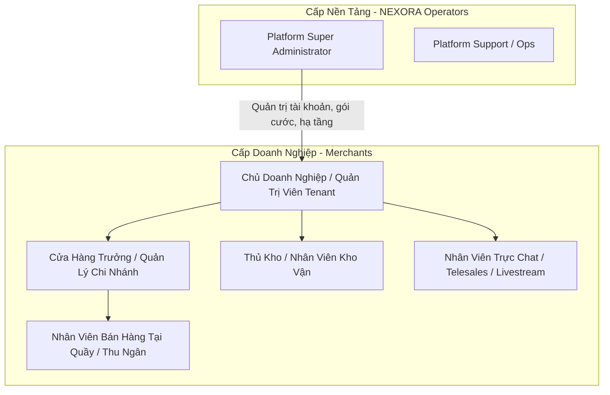

# Chân Dung Người Dùng — Target Users & Personas

> Trạng thái thông tin: `[CONFIRMED]` cho vai trò vận hành của khách hàng khởi đầu | `[PROPOSED]` cho mô hình SaaS thương mại hóa.

NEXORA phục vụ hai cấp độ người dùng chính: **Người dùng cấp Nền tảng (Platform Level)** và **Người dùng cấp Doanh nghiệp (Tenant Level)**.

---

## 1. Phân Tầng Người Dùng Tổng Thể

---

## 2. Chi Tiết Các Nhóm Người Dùng (User Personas)

### 2.1. Platform Super Administrator (Quản trị viên nền tảng NEXORA)
- **Ai là họ?** Đội ngũ kỹ thuật hoặc vận hành của công ty chủ quản NEXORA.
- **Mục tiêu:** Quản trị toàn bộ hệ sinh thái, cấu hình gói thuê bao (Pricing Plans), giám sát tài nguyên máy chủ, kích hoạt hoặc khóa tài khoản doanh nghiệp vi phạm hoặc quá hạn thanh toán.
- **Nhu cầu chính:** Dashboard tổng quan số lượng Tenant, doanh thu thuê bao định kỳ (MRR/ARR), nhật ký lỗi hệ thống và công cụ cấu hình tính năng cho từng Tenant.

---

### 2.2. Tenant Administrator (Chủ doanh nghiệp bán lẻ)
- **Ai là họ?** Giám đốc, chủ chuỗi bán lẻ đồ gia dụng hoặc quản lý kinh doanh tổng thể.
- **Nhu cầu chính:**
  - Nắm bắt doanh thu toàn diện trong ngày từ 2 cửa hàng và các sàn TMĐT (Shopee, TikTok, Facebook).
  - Kiểm soát dòng tiền, công nợ, tỷ lệ hoàn hàng và hiệu suất bán hàng của từng nhân viên.
  - Quản lý phân quyền tài khoản cho nhân viên cấp dưới; cấu hình các chi nhánh và kho hàng.
- **Nỗi đau hiện tại:** Phải tổng hợp báo cáo thủ công qua nhiều file Excel; không nắm được lợi nhuận thực tế sau khi trừ phí sàn TMĐT.

---

### 2.3. Store Manager (Cửa hàng trưởng)
- **Ai là họ?** Người chịu trách nhiệm vận hành tại 1 chi nhánh cửa hàng cụ thể.
- **Nhu cầu chính:**
  - Kiểm soát ca làm việc, tiền mặt đầu ca/cuối ca của nhân viên thu ngân.
  - Theo dõi doanh số bán hàng tại cửa hàng trong ngày.
  - Thực hiện yêu cầu nhập hàng từ kho tổng về cửa hàng hoặc chuyển hàng giữa các chi nhánh.
- **Nỗi đau hiện tại:** Hàng hết tại cửa hàng nhưng không biết cửa hàng khác còn hay không để điều phối kịp thời cho khách.

---

### 2.4. Cashier / POS Staff (Nhân viên bán hàng & thu ngân tại quầy)
- **Ai là họ?** Nhân viên trực tiếp giao tiếp với khách hàng tại quầy thanh toán.
- **Nhu cầu chính:**
  - Tìm kiếm sản phẩm siêu tốc bằng máy quét mã vạch (Barcode Scanner) hoặc gõ nhanh tên/SKU.
  - Tạo đơn, áp dụng chương trình khuyến mãi, tính tiền mặt/chuyển khoản (VietQR) và in hóa đơn bán lẻ nhanh chóng.
  - Kiểm tra nhanh số lượng tồn kho của một món đồ gia dụng ngay tại màn hình bán hàng.
- **Nỗi đau hiện tại:** Phần mềm cũ chậm, giật lag vào giờ cao điểm, quy trình thanh toán nhiều bước rườm rà làm khách phải chờ đợi.

---

### 2.5. Warehouse Staff (Thủ kho / Nhân viên kho vận)
- **Ai là họ?** Người phụ trách tiếp nhận, sắp xếp và đóng gói hàng hóa tại kho.
- **Nhu cầu chính:**
  - Tạo phiếu nhập kho từ nhà cung cấp kèm giá vốn và số lô/hạn bảo hành (nếu có).
  - In phiếu nhặt hàng (Pick List) và phiếu đóng gói (Packing Slip) cho các đơn hàng online dồn về từ Shopee/TikTok Shop.
  - Kiểm kê tồn kho định kỳ và điều chỉnh chênh lệch tồn thực tế so với phần mềm.
- **Nỗi đau hiện tại:** Đóng nhầm biến thể màu sắc/kích thước sản phẩm do mã SKU không đồng nhất giữa sàn và phần mềm nội bộ.

---

### 2.6. Online Sales / Chat Agents (Nhân viên trực chat & chốt đơn)
- **Ai là họ?** Đội ngũ trực Fanpage Facebook, TikTok Shop, Messenger trả lời tư vấn khách hàng.
- **Nhu cầu chính:**
  - Một màn hình gom toàn bộ tin nhắn từ nhiều fanpage, không cần chuyển tab trình duyệt.
  - Xem ngay số lượng tồn kho sản phẩm khi khách đang hỏi chat.
  - Điền thông tin người nhận, chọn sản phẩm và tạo đơn hàng gửi sang bộ phận kho chỉ bằng vài thao tác kéo thả hoặc bấm nút ngay cạnh khung chat.
- **Nỗi đau hiện tại:** Tin nhắn khách bị sót do thuật toán phân bổ của Facebook/TikTok; copy paste thông tin địa chỉ khách qua lại giữa khung chat và phần mềm tạo đơn tốn nhiều thời gian và dễ sai sót.
