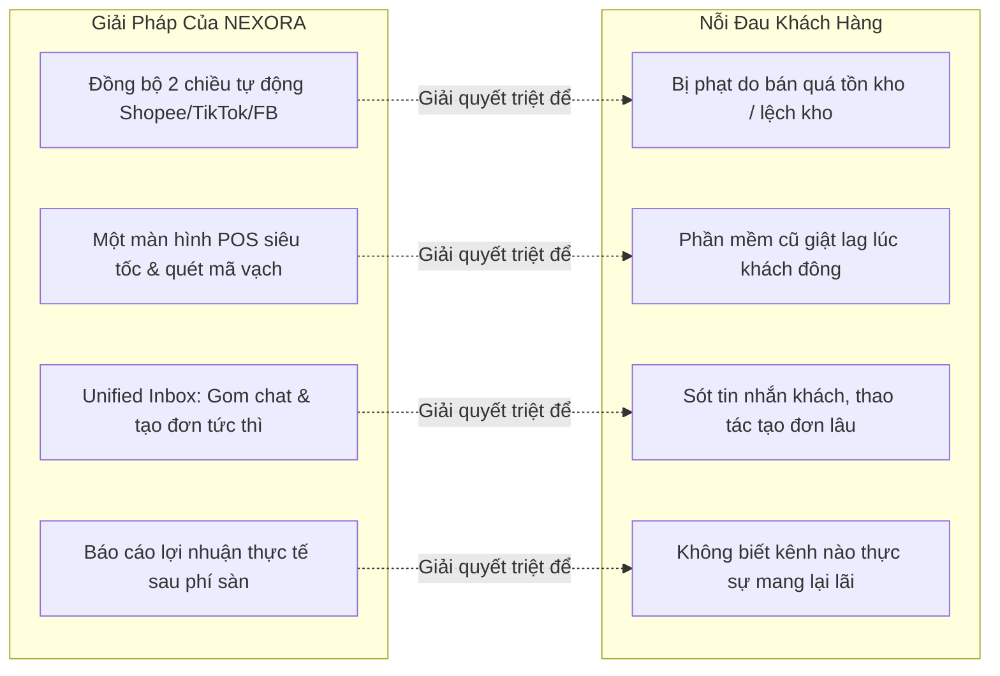

# Định Vị Giá Trị — Value Proposition

> Trạng thái thông tin: `[PROPOSED]` Phân tích lợi thế cạnh tranh và giá trị mang lại cho khách hàng bán lẻ.

## 1. Bản Đồ Định Vị Giá Trị (Value Proposition Canvas)

NEXORA giải quyết trực diện những khó khăn cốt lõi của nhà bán lẻ đa kênh thông qua mô hình hợp nhất:

---

## 2. So Sánh NEXORA Với Các Giải Pháp Hiện Hành

| Tiêu Chí So Sánh | Phần Mềm Thuê Ngoài Đóng Gói (Hiện Tại) | Các Ứng Dụng Đơn Lẻ (Point Solutions) | Nền Tảng Hợp Nhất NEXORA |
| :--- | :--- | :--- | :--- |
| **Quyền tự chủ & Tùy biến** | Thấp, bị khóa vào roadmap của nhà cung cấp | Rất thấp, dữ liệu nằm rải rác ở 3-4 app khác nhau | **Tuyệt đối**, doanh nghiệp tự chủ 100% roadmap |
| **Độ trễ đồng bộ tồn kho** | Định kỳ 15-30 phút (dễ gây overselling) | Phụ thuộc bên thứ ba kết nối qua Zapier/Make | **Gần thời gian thực** (Webhook + Event Queue) |
| **Hộp thư hội thoại & Tạo đơn**| Phải mua thêm gói tiện ích hoặc phần mềm chat riêng | Phần mềm chat riêng không liên kết tồn kho thực tế | **Tích hợp sẵn**: xem tồn kho & tạo đơn ngay tại ô chat |
| **Mô hình chi phí dài hạn** | Chi phí tăng theo số kênh và quy mô chi nhánh | Chi phí cộng dồn từ nhiều phần mềm riêng biệt | **Chi phí biên thấp**, tối ưu biên lợi nhuận cho chuỗi |
| **Khả năng mở rộng đa chi nhánh**| Cần nâng cấp gói đắt đỏ, phức tạp | Khó liên kết dữ liệu giữa các cửa hàng | **Chuẩn hóa Multi-Store / Multi-Warehouse** từ lõi |

---

## 3. Lợi Ích Đo Lường Được (Measurable ROI)

1. **Tiết kiệm thời gian:** Giảm **60%** thời gian nhập liệu thủ công đơn hàng và thông tin khách hàng từ các kênh mạng xã hội.
2. **Loại bỏ tình trạng Overselling:** Giảm **95%** nguy cơ bán hàng quá số lượng tồn kho trên Shopee và TikTok Shop nhờ cơ chế trừ tồn tức thì.
3. **Nâng cao tốc độ phục vụ:** Rút ngắn thời gian tạo đơn tại quầy xuống dưới **15 giây/đơn hàng**.
4. **Tăng tỷ lệ chuyển đổi chốt đơn:** Tăng **20–30%** tốc độ phản hồi tin nhắn của khách hàng trên Facebook/Messenger, giúp chốt đơn trước khi khách rời sang đối thủ.
