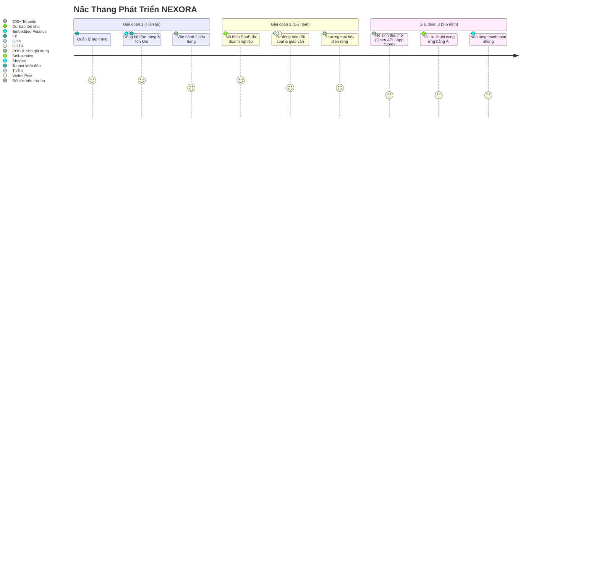

# Tầm Nhìn Chiến Lược — NEXORA Vision

> Trạng thái thông tin: `[PROPOSED]` Định hướng chiến lược công nghệ & kinh doanh dài hạn.

## 1. Tuyên Bố Tầm Nhìn (Vision Statement)

> **"Trở thành hệ điều hành thương mại hợp nhất (Commerce Operating System) hàng đầu tại Việt Nam và khu vực, trao quyền cho các doanh nghiệp bán lẻ làm chủ toàn bộ chuỗi giá trị từ kênh tiếp thị trực tuyến đến điểm bán hàng vật lý với chi phí tối ưu và năng lực công nghệ vượt trội."**

---

## 2. Các Giai Đoạn Tiến Hóa

NEXORA không dừng lại ở một công cụ quản lý bán hàng (Point of Sale Tool) đơn thuần, mà phát triển qua 3 nấc thang giá trị:

---

## 3. Các Nguyên Tắc Dẫn Đường Chiến Lược

### 3.1. "Merchant First" — Trọng Tâm Là Nhà Bán Lẻ
Mọi tính năng, từ thao tác tạo đơn hàng tại quầy đến quản lý hội thoại trên mạng xã hội, đều phải hướng đến tiêu chí: **Đơn giản, tốc độ và giảm thiểu sai sót do con người**. Thời gian tạo một đơn hàng tại quầy không được quá 15 giây.

### 3.2. "Data Sovereignty" — Tôn Trọng Quyền Sở Hữu Dữ Liệu
Mỗi Tenant có toàn quyền đối với dữ liệu sản phẩm, khách hàng, giao dịch tài chính của mình. Dữ liệu được bảo mật nhiều lớp và cam kết không bị khai thác chéo hoặc rò rỉ cho đối thủ cạnh tranh.

### 3.3. "Zero-Lock-In Ecosystem" — Khả Năng Tương Thích Mở
NEXORA xây dựng kiến trúc API mở để doanh nghiệp dễ dàng xuất nhập dữ liệu, kết nối với các hệ thống phần mềm kế toán, ERP hoặc các đơn vị fulfillment chuyên biệt khi phát triển lên quy mô lớn.
