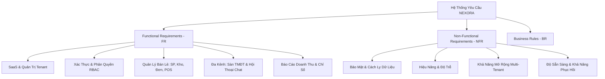

# Quản Lý Yêu Cầu Nghiệp Vụ — Requirements Overview

Tài liệu này định nghĩa phương pháp luận quản lý yêu cầu phần mềm và ma trận phân loại yêu cầu cho nền tảng **NEXORA — Commerce Management Platform**.

---

## 1. Phương Pháp Luận Phân Tích & Định Danh

Mọi yêu cầu nghiệp vụ và kỹ thuật trong dự án NEXORA đều được chuẩn hóa bằng mã định danh duy nhất (Unique Requirement ID) nhằm phục vụ công tác truy vết (Traceability Matrix) từ khâu thiết kế, lập trình đến kiểm thử tự động:

- **Yêu cầu chức năng (Functional Requirements):** Mang tiền tố `FR-[MODULE]-[XXX]` (Ví dụ: `FR-AUTH-001`, `FR-ORD-005`).
- **Yêu cầu phi chức năng (Non-Functional Requirements):** Mang tiền tố `NFR-[CATEGORY]-[XXX]` (Ví dụ: `NFR-SEC-001`, `NFR-PERF-003`).
- **Quy tắc nghiệp vụ (Business Rules):** Mang tiền tố `BR-[MODULE]-[XXX]` (Ví dụ: `BR-INV-001`, `BR-ORD-002`).

---

## 2. Hệ Thống Nhãn Trạng Thái

Mỗi mục yêu cầu đều đi kèm nhãn trạng thái chính xác:
- `[CONFIRMED]`: Đã được khách hàng/chủ sở hữu sản phẩm chốt chính thức.
- `[PROPOSED]`: Giải pháp đề xuất từ đội BA/Tech Lead dựa trên thông lệ tốt nhất của ngành thương mại điện tử.
- `[HYPOTHESIS]`: Giả thuyết cần được kiểm chứng thông qua người dùng thực tế hoặc dữ liệu đo lường.
- `[UNDECIDED]`: Đang chờ quyết định cuối cùng từ khách hàng.

---

## 3. Bản Đồ Phân Phổ Yêu Cầu

---

## 4. Danh Mục Tài Liệu Chi Tiết

- [**FUNCTIONAL_REQUIREMENTS.md**](./FUNCTIONAL_REQUIREMENTS.md): Danh mục chi tiết các yêu cầu chức năng theo từng phân hệ.
- [**NON_FUNCTIONAL_REQUIREMENTS.md**](./NON_FUNCTIONAL_REQUIREMENTS.md): Quy chuẩn về bảo mật, hiệu năng, khả năng mở rộng và độ ổn định.
- [**USER_ROLES.md**](./USER_ROLES.md): Ma trận phân quyền chi tiết cho từng chức danh người dùng (RBAC).
- [**USER_FLOWS.md**](./USER_FLOWS.md): Sơ đồ các luồng tương tác của người dùng trên hệ thống.
- [**USE_CASES.md**](./USE_CASES.md): Kịch bản trường hợp sử dụng (Use Cases) chi tiết với luồng ngoại lệ.
- [**MVP_SCOPE.md**](./MVP_SCOPE.md): Ranh giới phạm vi triển khai cho phiên bản đầu tiên (In-Scope vs Out-of-Scope).
- [**ACCEPTANCE_CRITERIA.md**](./ACCEPTANCE_CRITERIA.md): Tiêu chuẩn nghiệm thu kiểm thử được (Gherkin format).
