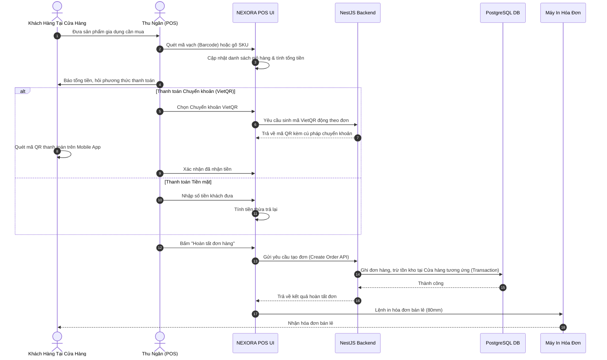
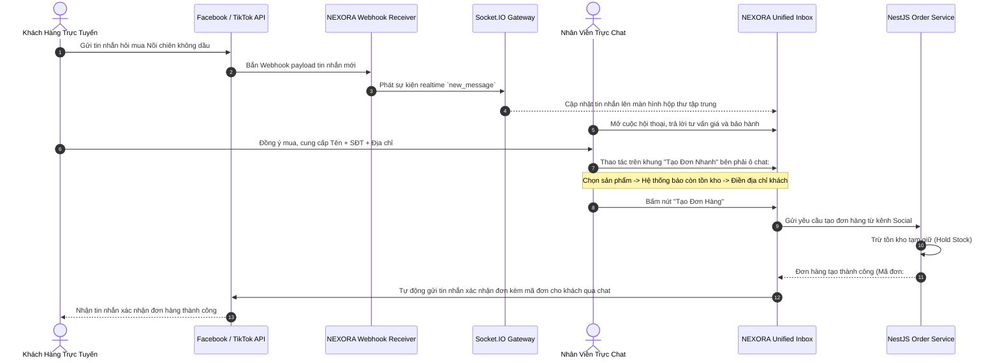
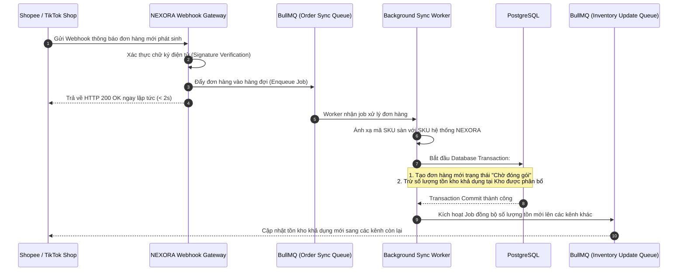

# Sơ Đồ Luồng Người Dùng — Core User Flows

> Trạng thái thông tin: `[CONFIRMED]` cho luồng bán hàng & chat chốt đơn | `[PROPOSED]` cho luồng đồng bộ đa kênh.

Tài liệu này trực quan hóa các luồng thao tác cốt lõi của người dùng và hệ thống bằng sơ đồ Mermaid.

---

## 1. Luồng Bán Hàng Tại Quầy POS (In-Store Checkout Flow)

Luồng thao tác của nhân viên thu ngân tại 2 cửa hàng đồ gia dụng:

---

## 2. Luồng Xử Lý Hội Thoại & Chốt Đơn Trực Tiếp (Chat-to-Order Flow)

Luồng thao tác của nhân viên trực Fanpage / TikTok Shop:

---

## 3. Luồng Đồng Bộ Đơn Hàng Sàn TMĐT (Shopee / TikTok Shop Sync Flow)

Luồng xử lý tự động khi có đơn hàng mới phát sinh trên sàn thương mại điện tử:

